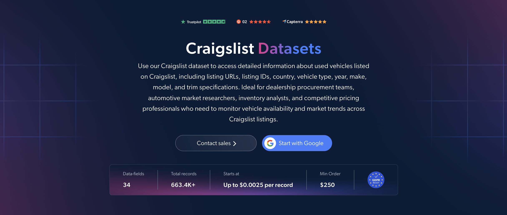

# Craigslist 数据集样本

<h2>包含 1000 条 Craigslist 轿车和卡车信息的样本数据集</h2>

<a href="https://www.bright.cn/products/datasets/craigslist">
   
</a>

一个包含 1000 条 Craigslist 二手轿车和卡车信息的数据集样本。该数据集使用 <b>Bright Data API</b> 提取。

<h2>该数据集包含的部分数据点：</h2>

* ```url```：Craigslist 信息的 URL
* ```listing_id```：唯一的 Craigslist 帖子 ID
* ```type```：车辆类型，例如轿车、SUV 或皮卡
* ```year```：生产年份
* ```make```：车辆品牌或制造商
* ```model```：车辆型号
* ```trim```：车型版本或配置
* ```price```：车辆标价
* ```currency```：价格币种
* ```mileage```：车辆里程数
* ```condition```：车辆状况
* ```title_status```：产权状态，例如正常产权或报废产权
* ```vin```：17 位车辆识别码
* ```engine```：发动机类型及详细信息
* ```cylinders```：气缸数量
* ```fuel```：燃料类型
* ```transmission```：变速箱类型
* ```drivetrain```：驱动类型
* ```paint_color```：车辆漆面颜色
* ```description```：信息中对车辆的描述
* ```city```：信息发布所在城市
* ```state```：信息发布所在州
* ```posted_at```：信息发布日期和时间
* ```images```：车辆照片的 URL

以及更多内容。

这是“Craigslist 轿车和卡车信息（公共数据）”数据集的样本子集，完整数据集包含超过 <b>663,000 条信息</b>。

可用的数据集文件格式：<b>JSON、NDJSON、JSON Lines、CSV、XLSX 或 Parquet。还可选择将文件压缩为 .gz 格式</b>。

数据集交付方式选项：<b>电子邮件、API 下载、Webhook、Amazon S3、Google Cloud Storage、Google Cloud PubSub、Microsoft Azure、Snowflake、SFTP</b>。

更新频率：<b>单次、每日、每周、每月、每季度、每半年或自定义频率</b>。

可在提取的数据点之外添加数据增强服务：<b>可按需提供。</b>

<b>[获取完整的 Craigslist 数据集](https://www.bright.cn/products/datasets/craigslist)</b>。

<a href="https://www.bright.cn/products/datasets/craigslist">
</a>

<h2>Craigslist 数据集有哪些使用场景？</h2>

<h3>1. 二手车价格分析</h3>
经销商和分析师使用 Craigslist 数据集，对数十万条广告中的标价与车辆年份、里程数和车况进行比较。这有助于构建折旧曲线，并显示各个市场中同类车辆的实际要价。产权状态和驱动方式等详细信息，让你可以在建立价格模型前轻松区分可直接零售的车辆与报废车辆及项目车辆。

<h3>2. 区域市场比较</h3>
Craigslist 按都市区划分，因此可以按城市和州比较信息。按地区比较价格，可以发现某款车型在哪些地区能以溢价出售，以及哪些地区的库存长期滞销，从而帮助买家和经销商决定从哪里采购以及在哪里销售车辆。

<h3>3. 库存与供应跟踪</h3>
汽车行业研究人员按发布日期跟踪各品牌和车型的信息，以衡量每周有多少二手车供应进入各个市场。这有助于揭示供应变化，并帮助采购团队在市场发生变化前规划采购。

<h2>为学术研究人员和 NGO 免费提供网页爬虫工具及数据集</h2>

Bright Initiative 向领先的学术院系和研究人员，以及致力于推动各类环境与社会事业的 NGO 和 NPO，提供 Bright Data 的 <b>[网页爬虫工具 API](https://www.bright.cn/products/web-scraper)</b> 和 <b>[即用型数据集](https://www.bright.cn/products/datasets)</b>。你可以在<b>[这里](https://brightinitiative.com)</b>提交申请。
